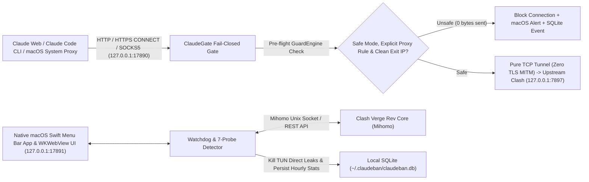

<div align="center">

# ClaudeGate

**Native macOS & Windows Anti-Ban Proxy Gate, 7-Probe Network Detector & Clash Verge Rev (Mihomo) Auto-Fixer for Claude & Anthropic**

**English** | [简体中文](./README.zh-CN.md) | [llms.txt (For AI Agents)](./llms.txt)

[-000000?logo=apple&logoColor=white)](https://github.com/hsjx945/claudegate/releases/latest)
[](https://github.com/hsjx945/claudegate/releases/latest)
[](https://nodejs.org/)
[](https://github.com/clash-verge-rev/clash-verge-rev)
[](./README.md#architecture)
[](./LICENSE)

</div>

**ClaudeGate** (`claudegate`) is a native **macOS menu bar** and **Windows system tray** application backed by a zero-decryption **fail-closed proxy gate** built for **Clash Verge Rev (Mihomo)** users who rely on **Claude Web (`claude.ai`)**, **Claude Code CLI**, and the **Anthropic API (`api.anthropic.com`)**. It stops direct-IP leaks and restricted-region egress with **0 bytes leaked**, alerts with native desktop banners and audible sound whenever traffic bypasses the proxy, scores IP purity and DNS/IPv6/WebRTC leaks with a 7-probe detector, and fixes misconfigured Clash rules and nodes in one click.

> **Pre-built Desktop Releases (No Node.js Required):** Download `.dmg` / `.zip` for **macOS (Apple Silicon & Intel)** and **Windows x64** on the [**GitHub Releases page**](https://github.com/hsjx945/claudegate/releases/latest).

---

## Why Claude & Anthropic Accounts Get Flagged

Most unexpected Claude account bans or verification loops come from silent routing mistakes rather than intentional policy violations:

1. **Clash switched to Direct or `GLOBAL -> DIRECT`**: One accidental click sends `claude.ai` or telemetry calls out over your domestic IP.
2. **Unsupported exit country**: A rule accidentally routes Claude traffic through restricted jurisdictions (`CN`, `HK`, `MO`, `RU`, `KP`, `IR`, `BY`, `SY`, `CU`).
3. **Rule gaps across the 29-domain Claude ecosystem**: Even if `claude.ai` and `anthropic.com` are proxied, supporting services (`claudeusercontent.com`, `downloads.claude.ai`, `statsig.com`, `sentry.io`, `stripe.com`, `intercom.io`, `modelcontextprotocol.io`, Datadog intake, etc.) may fall through to `MATCH` or `DIRECT`, exposing mismatched IPs on the same session.
4. **Silent TUN direct leaks, DNS leaks, or IPv6 leaks**: Background CLI tools (e.g., Claude Code telemetry) bypass system proxies via TUN mode, or IPv6/DNS resolves outside the proxy tunnel.
5. **Datacenter / proxy-flagged exit IPs & frequent country hopping**: Switching rapidly across countries or using heavily shared datacenter IPs raises risk scores.

---

## Plain Clash Verge Rev vs. ClaudeGate + Clash Verge Rev

| Capability | Plain Clash Verge Rev | ClaudeGate + Clash Verge Rev |
| :--- | :---: | :---: |
| **Pre-flight 0-byte fail-closed block** | ❌ Connects direct on rule miss | ✅ Blocks HTTP / HTTPS `CONNECT` / SOCKS5 at 0 bytes |
| **TLS Fingerprint Preservation** | ✅ | ✅ **Zero TLS MITM** (pure TCP / SNI tunnel) |
| **29-Domain Claude Ecosystem Audit** | ❌ Manual YAML check | ✅ Live rule matching & one-click `Script.js` patch |
| **TUN Direct-Leak Auto-Kill** | ❌ | ✅ Kills offending direct sockets via `DELETE /connections/:id` |
| **7-Probe IP / DNS / IPv6 / WebRTC Detector** | ❌ | ✅ Built-in `S`–`F` scoring across 5 dimensions |
| **One-Click Auto-Fix + Live Hot-Reload** | ❌ | ✅ Fixes mode, `GLOBAL`, node country, rules & `ipv6: false` |
| **Native macOS Menu Bar Status Card** | Partial | ✅ Country badge, node, 24h traffic, Launch at Login |
| **Hourly Traffic & Block Audit DB** | In-memory | ✅ Local SQLite (`~/.claudeban/claudeban.db`, 90-day retention) |

---

## Architecture

ClaudeGate sits strictly on `127.0.0.1` between local macOS apps / CLI tools and Clash Verge Rev, inspecting only the target `host:port` (from HTTP request lines, HTTPS `CONNECT`, or SOCKS5 headers) plus live Mihomo state via Unix Socket (`/var/run/clash-verge-service/users/<uid>/verge-mihomo.sock`). **No TLS certificates are installed and no encrypted payloads are ever decrypted.**



---

## Core Features

### 1. 0-Byte Fail-Closed Local Proxy Gate (`127.0.0.1:17890`)
- Supports **HTTP**, **HTTPS `CONNECT`**, and **SOCKS5** on a single local port without TLS MITM.
- Guards **29 default Claude / Anthropic ecosystem domains** (and custom user domains):
  - Core & Apps: `anthropic.com`, `claude.ai`, `claude.com`, `claude.app`, `claude.dev`, `claude.new`, `claude.site`, `clau.de`, `chatbotclaude.com`, `ant.dev`, `antspace.dev`, `anthropic.team`, `claudeacademy.com`, `claudestudio.com`, `servd-anthropic-website.b-cdn.net`
  - Artifacts & MCP: `claudeusercontent.com`, `downloads.claude.ai`, `modelcontextprotocol.io`, `claudemcpclient.com`, `claudemcpcontent.com`
  - Telemetry, Billing & Support: `sentry.io`, `statsig.com`, `growthbook.io`, `usefathom.com`, `http-intake.logs.us5.datadoghq.com`, `browser-intake-us5-datadoghq.com`, `stripe.com`, `intercom.io`, `intercomcdn.com`
- Refuses the connection immediately (**0 bytes forwarded upstream**) if Clash is offline, in `direct` mode, routing via `GLOBAL -> DIRECT`, matching a `DIRECT` rule, or using an exit IP in a banned region (`CN, HK, MO, RU, KP, IR, BY, SY, CU`).
- Recovery-aware cross-country jump detection (`CN -> JP` recovery does not trigger false jump warnings, and alerts clear once the exit IP stabilizes).

### 2. 7-Probe Network Risk & IP Purity Detector (`S`–`F` Grading)
Built into the **网络体检 (Network Detector)** tab with a 5-dimension weighted score (`100` max, graded `S` / `A` / `B` / `C` / `F`):
1. **Domestic Direct Baseline IP** (verifies local ISP presence outside the proxy).
2. **Proxy Exit IP Purity & Reputation** (detects residential/ISP vs. datacenter/hosting vs. flagged proxy ASN/ISP).
3. **Exit Stability** (multi-sample consistency check across requests).
4. **DNS Leak Check** (`edns.ip-api.com` recursive DNS geo check + Clash TUN `dns-hijack` check).
5. **IPv6 Leak Check** (verifies Mihomo `ipv6: false` and public IPv6 egress absence).
6. **WebRTC UDP Leak Check** (client-side `RTCPeerConnection` ICE candidate inspection in the UI).
7. **Environment Consistency & Anthropic 3-Endpoint Reachability** (system timezone vs. proxy IP timezone, plus live latency and routing verification for `claude.ai`, `api.anthropic.com`, and `platform.claude.com`).

### 3. One-Click Auto-Fix for Clash Verge Rev (`POST /api/actions/auto-fix`)
Safely repairs issues detected by Watchdog or the Network Detector:
- Switches Clash mode back to `rule` if set to `direct` or misconfigured `global`.
- Reassigns `GLOBAL` away from `DIRECT` to a clean, non-banned proxy node.
- Switches the active Claude selector group away from banned regions (`CN/HK/MO/RU/...`) using safe-node filtering (skipping info banners like remaining traffic/expiry).
- Injects explicit `DOMAIN-SUFFIX` rules for all missing Claude ecosystem domains plus `ipv6: false` into Clash Verge's global `Script.js` (so subscription updates preserve protection) and applies an inline YAML hot-reload via Mihomo `PUT /configs?force=true` while preserving your existing selector choices across all other policy groups.

### 4. TUN Direct-Leak Watchdog & SQLite Traffic Auditor
- Polls Mihomo `/connections` every second via Unix socket, automatically terminating any TUN/direct connection matching protected Claude domains (`DELETE /connections/:id`) and sending a native macOS desktop notification.
- Aggregates hourly upload/download byte counts by domain, proxy node, and process into SQLite (`~/.claudeban/claudeban.db`, powered by Node.js built-in `node:sqlite`, automatically pruned after 90 days).

### 5. Native macOS Menu Bar App (`Swift + AppKit + WKWebView`)
- Runs unobtrusively as a menu bar resident app (`LSUIElement = true`) showing your current exit country code (`JP`, `US`, `SG`, etc.) or block alert status.
- High-contrast status card showing guard health, Clash mode & TUN state, exit IP (with one-click privacy mask toggle in the UI), primary proxy node, 24h traffic totals, and system proxy takeover state.
- Supports **Launch at Login** (`~/Library/LaunchAgents/com.claudeban.claudegate.plist`), one-click macOS system proxy toggle (`networksetup`), audit log clearing, and customizable proxy/upstream ports.

---

## Quick Start

### Prerequisites
- **macOS 13+** (`arm64` or `x86_64`)
- **Node.js 22.5+** (required for built-in `node:sqlite` and `--experimental` free ESM execution)
- **Xcode Command Line Tools** (`swiftc`, `iconutil` — only needed when building the native `.app` bundle)
- **Clash Verge Rev** (or any Mihomo/Clash core exposing REST API / Unix socket) running on `127.0.0.1:7897`

### Option 1: Pre-built Desktop Releases (macOS & Windows)

Download the latest self-contained bundle from [**Releases**](https://github.com/hsjx945/claudegate/releases/latest) (portable Node.js runtime included):
- **macOS (Apple Silicon)**: `ClaudeGate-<version>-macos-arm64.dmg` — drag `ClaudeGate.app` into `/Applications` (if Gatekeeper prompts on first launch: `xattr -cr /Applications/ClaudeGate.app`).
- **macOS (Intel)**: `ClaudeGate-<version>-macos-x64.dmg`
- **Windows 10/11 (x64)**: `ClaudeGate-<version>-windows-x64.zip` — extract and double-click `ClaudeGate.exe` (runs in the Windows system tray).

### Option 2: Build Native App from Source

**macOS Menu Bar App (`Swift + AppKit + WKWebView`):**

```bash
git clone https://github.com/hsjx945/claudegate.git
cd claudegate
npm install

# Build and install /Applications/ClaudeGate.app
bash scripts/build-app.sh --install
open /Applications/ClaudeGate.app
```

**Windows System Tray App (`C# WinForms + .NET Framework`):**

```powershell
git clone https://github.com/hsjx945/claudegate.git
cd claudegate
npm install
powershell -ExecutionPolicy Bypass -File scripts/build-windows.ps1
```

### Option 2: CLI / Headless Mode

```bash
npm install
npm run build

# 1. Read-only pre-flight check of Clash Verge & current exit IP
npm run check

# 2. Start the ClaudeGate proxy gate (17890) & web dashboard (17891)
npm start
```

Open **`http://127.0.0.1:17891`** in your browser.

### Using ClaudeGate with Claude Code CLI or Terminal Tools

```bash
export HTTP_PROXY=http://127.0.0.1:17890
export HTTPS_PROXY=http://127.0.0.1:17890
export ALL_PROXY=socks5://127.0.0.1:17890
export NO_PROXY=localhost,127.0.0.1,::1
```

### Toggle macOS System Proxy via CLI

```bash
node dist/src/index.js proxy-on   # Route macOS HTTP/HTTPS/SOCKS proxy through 127.0.0.1:17890
node dist/src/index.js proxy-off  # Restore previous system proxy settings (e.g. 127.0.0.1:7897)
```

---

## Frequently Asked Questions (FAQ)

**Does ClaudeGate decrypt HTTPS traffic or install root CA certificates?**
No. ClaudeGate uses pure TCP passthrough (`net.Socket` piping) for HTTPS `CONNECT` and SOCKS5 tunnels. It never performs TLS MITM, preserves your browser/CLI TLS fingerprint completely, and only evaluates the hostname/port before forwarding any bytes.

**What happens if I switch Clash Verge Rev to Direct mode while using Claude?**
For any of the 29 guarded Claude/Anthropic domains, ClaudeGate immediately refuses new proxy connections at **0 bytes sent** (`HTTP 503 X-ClaudeGate-Blocked`), kills active TUN direct leaks via Mihomo's API if enabled, logs the event, and sends a macOS notification. Non-Claude traffic continues normally.

**Does One-Click Auto-Fix break my Clash Verge subscription or other proxy groups?**
No. ClaudeGate appends a safe rule-injection wrapper to Clash Verge's global `Script.js` (which survives subscription updates) and reloads an inline YAML payload while restoring your previous selections on unrelated policy groups (such as streaming or gaming groups).

**Is any telemetry or IP history sent to external servers?**
No telemetry is collected by ClaudeGate. All traffic metrics, guard events, and configuration live locally in `~/.claudeban/`. Network checks query public diagnostic endpoints (`ip-api.com`, `edns.ip-api.com`, `cloudflare.com`, `claude.ai`, `api.anthropic.com`, `platform.claude.com`) directly on demand.

**How does ClaudeGate work with Claude Code CLI?**
Set `HTTP_PROXY`, `HTTPS_PROXY`, and `ALL_PROXY` to `http://127.0.0.1:17890` / `socks5://127.0.0.1:17890` in your shell profile, or toggle macOS system proxy takeover from the ClaudeGate menu bar.

---

## Development & Tests

```bash
npm test
```

Runs the TypeScript build (`tsc`) and Node.js built-in test runner across unit and end-to-end suites (`guard`, `rules-engine`, `auto-fixer`, `network-detector`, `proxy-e2e`).

---

## License

[MIT](./LICENSE) © 2026 hsjx945
