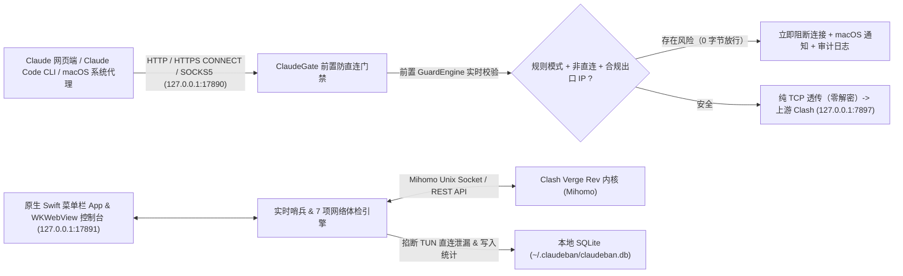

<div align="center">

# ClaudeGate (`claudegate`)

**macOS & Windows 原生托盘/菜单栏 Claude / Anthropic 防封号代理门禁、7 项网络风控体检与 Clash Verge Rev (Mihomo) 一键修复工具**

[English](./README.md) | **简体中文** | [llms.txt (AI 检索摘要)](./llms.txt)

[-000000?logo=apple&logoColor=white)](https://github.com/hsjx945/claudegate/releases/latest)
[](https://github.com/hsjx945/claudegate/releases/latest)
[](https://nodejs.org/)
[](https://github.com/clash-verge-rev/clash-verge-rev)
[](./README.zh-CN.md#%E6%9E%B6%E6%9E%84%E5%8E%9F%E7%90%86)
[](./LICENSE)

</div>

**ClaudeGate**（仓库名 `claudegate`）是一款支持 **macOS 菜单栏** 与 **Windows 系统托盘** 的本地零解密前置安全门禁、网络环境体检与流量审计工具，专为 **Clash Verge Rev (Mihomo)** 用户打造。它可在连接建立前的 **0 字节阶段（Fail-Closed）** 拦截直连或受限地区出口，并在 Clash 离线或系统代理与 TUN 均未开启导致网络未走代理时**弹窗并发出提示音告警**；内置 **7 项 IP 纯净度与泄漏检测（DNS / IPv6 / WebRTC）** 及 **一键自动修复**。

> **免安装 Node.js 开箱即用版下载**：前往 [**GitHub Releases 页面**](https://github.com/hsjx945/claudegate/releases/latest) 直接获取 **macOS (Apple Silicon / Intel)** `.dmg`/`.zip` 与 **Windows x64** 绿色压缩包（内置便携 Node.js 运行时）。

---

## 为什么 Claude / Claude Code 账号容易触发风控或封号？

绝大多数非主观违规的封号或频繁人机验证，源于代理链路里的隐蔽失误：

1. **Clash 误切直连或 `GLOBAL -> DIRECT`**：切换测试网络后忘记改回规则模式，导致请求裸奔直连。
2. **节点落入受限地区**：策略组或自动测速切到了受限国家/地区节点（默认拦截 `CN, HK, MO, RU, KP, IR, BY, SY, CU`）。
3. **29 个 Claude 生态关联域名规则缺失**：即使 `claude.ai` 走了代理，关联的 `claudeusercontent.com`、`downloads.claude.ai`、`statsig.com`、`sentry.io`、`stripe.com`、`intercom.io`、`modelcontextprotocol.io` 等仍可能走兜底 `MATCH` 甚至直连，造成同会话多 IP 混杂。
4. **TUN 模式直连泄漏 / DNS 泄漏 / IPv6 泄漏**：终端 CLI（如 Claude Code）绕过系统代理直接走 TUN 网卡，或 DNS/IPv6 未被代理接管。
5. **机房/代理标记 IP 与跨国频繁跳变**：使用高风险数据中心 IP 或节点频繁跨国家切换。

---

## 仅使用 Clash Verge Rev vs. 使用 ClaudeGate + Clash Verge Rev

| 核心能力对比 | 仅用 Clash Verge Rev | ClaudeGate + Clash Verge Rev |
| :--- | :---: | :---: |
| **连接前 0 字节防直连熔断** | ❌ 规则缺失直接直连 | ✅ 在 HTTP / `CONNECT` / SOCKS5 握手前 0 字节拦截 |
| **TLS 指纹完整性** | ✅ | ✅ **绝不解密 TLS（无 MITM）**，纯 TCP 透传 |
| **29 个 Claude 生态域名审计** | ❌ 需手动逐条排查 | ✅ 实时规则匹配检查 + 一键写入 `Script.js` |
| **TUN 直连泄漏自动掐断** | ❌ | ✅ 发现后调用 `DELETE /connections/:id` 立即掐断并弹窗 |
| **7 项 IP / DNS / IPv6 / WebRTC 体检** | ❌ | ✅ 5 维度加权评分（`S` / `A` / `B` / `C` / `F`） |
| **一键自动修复 + 实时热重载** | ❌ | ✅ 自动修复模式、`GLOBAL`、受限节点、规则与 `ipv6: false` |
| **原生 macOS 菜单栏状态卡片** | 基础 | ✅ 出口国家码角标、主节点、24h 流量、开机自启 |
| **历史流量与拦截审计留存** | 仅内存实时 | ✅ 本地 SQLite（`~/.claudeban/claudeban.db`，自动清理 90 天前数据） |

---

## 架构原理

ClaudeGate 仅监听本地 `127.0.0.1`：代理门禁端口为 `17890`，控制台端口为 `17891`。所有受控请求先经过前置策略引擎校验目标域名与 Clash Verge 状态（通过 `/var/run/clash-verge-service/users/<uid>/verge-mihomo.sock` 自动发现或 TCP 控制端口通信），确认安全后再纯 TCP 透传至上游 Clash（默认 `127.0.0.1:7897`）。**全程不安装根证书、不解密 HTTPS 载荷、不破坏客户端 TLS 指纹。**



---

## 核心功能

### 1. 0 字节 Fail-Closed 本地代理门禁 (`127.0.0.1:17890`)
- 单端口同时支持 **HTTP**、**HTTPS `CONNECT`** 与 **SOCKS5**，无需修改或解密 TLS。
- 默认守护 **29 个 Claude / Anthropic 生态域名**（并支持在控制台自定义新增）：
  - 核心与开发者域：`anthropic.com`、`claude.ai`、`claude.com`、`claude.app`、`claude.dev`、`claude.new`、`claude.site`、`clau.de`、`chatbotclaude.com`、`ant.dev`、`antspace.dev`、`anthropic.team`、`claudeacademy.com`、`claudestudio.com`、`servd-anthropic-website.b-cdn.net`
  - Artifacts 与 MCP：`claudeusercontent.com`、`downloads.claude.ai`、`modelcontextprotocol.io`、`claudemcpclient.com`、`claudemcpcontent.com`
  - 遥测、计费与客服：`sentry.io`、`statsig.com`、`growthbook.io`、`usefathom.com`、`http-intake.logs.us5.datadoghq.com`、`browser-intake-us5-datadoghq.com`、`stripe.com`、`intercom.io`、`intercomcdn.com`
- 当 Clash 未启动、处于 `direct` 直连模式、`GLOBAL -> DIRECT`、域名规则指向 `DIRECT` 或出口 IP 位于受限地区时，在连接建立瞬间 **0 字节阻断**。
- 支持恢复安全时的防误报跨国跳变判定（从受限地区如 `CN` 恢复到 `JP` 不会误判为频繁跳变）。

### 2. 7 项网络风险与 IP 纯净度检测 (`S`–`F` 分级评分)
内置 **网络体检** 标签页，从 5 个维度综合评分（满分 100，`S / A / B / C / F` 分级）：
1. **国内直连基准 IP**：确认本地直连出口对照基准。
2. **代理出口 IP 纯净度**：识别住宅/原生 ISP 与机房（Datacenter / Hosting）或代理标记 IP。
3. **出口稳定性探测**：多次连续采样校验出口 IP 是否一致。
4. **DNS 泄漏检测**：通过 `edns.ip-api.com` 检测递归解析出口及 Clash TUN `dns-hijack` 配置。
5. **IPv6 泄漏检测**：校验 Mihomo `ipv6: false` 与公网 IPv6 暴露情况。
6. **WebRTC UDP 泄漏检测**：在界面端通过 `RTCPeerConnection` 检测是否存在真实公网 IP 候选泄漏。
7. **环境一致性 & Anthropic 三端可达性**：比对本机时区与代理时区，并实测 `claude.ai`、`api.anthropic.com`、`platform.claude.com` 的可达性、状态码与延迟。

### 3. Clash Verge Rev 一键自动修复 (`POST /api/actions/auto-fix`)
发现安全隐患后点击一次即可完成全链路修复：
- 自动将 Clash 模式恢复为 `rule`；
- 将 `GLOBAL` 策略组从 `DIRECT` 切换为安全代理节点；
- 若 Claude 主节点落在受限地区，自动过滤无效信息项并切换为合规节点；
- 将缺失的 29 条显式代理规则与 `ipv6: false` 写入 Clash Verge 全局扩展脚本 `Script.js`（订阅更新不丢失），并通过内联 YAML 调用 `PUT /configs?force=true` 立即热重载生效，同时**完整保留其余所有策略组的既有节点选择**。

### 4. TUN 直连泄漏强杀哨兵 & SQLite 流量审计
- 每秒通过 Mihomo Socket 巡检活动连接，发现任意进程绕过代理、在 TUN 下走 `DIRECT` 访问受保护域名时，自动执行 `DELETE /connections/:id` 掐断并弹出 macOS 原生通知。
- 按小时持久化全网及 Claude 生态流量（支持按域名、代理节点、本地进程榜单查看），存储于 `~/.claudeban/claudeban.db`（使用 Node.js 内置 `node:sqlite`，自动清理 90 天前数据）。

### 5. 原生 macOS 菜单栏 App (`Swift + AppKit + WKWebView`)
- 右上角菜单栏常驻应用（`LSUIElement = true`），直观显示当前出口国家码（如 `JP`）或拦截警示。
- 下拉面板采用高对比度自适应状态卡片（运行状态、Clash 模式/TUN/版本、出口 IP、主节点、24h 流量、系统代理接管状态），快捷操作与系统功能分区清晰。
- 支持一键开关 **开机自动启动**（`LaunchAgents`）、一键接管 **macOS 系统代理**、一键脱敏遮罩界面 IP、清空审计日志及自定义端口与探测间隔。

---

## 快速开始

### 环境要求
- **macOS 13+**（Apple Silicon `arm64` 或 Intel `x86_64`）
- **Node.js 22.5+**（需内置 `node:sqlite`）
- **Xcode Command Line Tools**（构建原生 `.app` 时需要 `swiftc` 和 `iconutil`）
- **Clash Verge Rev**（或其他暴露标准 Mihomo REST API / Unix Socket 的内核，默认混合端口 `7897`）

### 方式一：直接下载 Release 客户端（macOS & Windows 免配环境）

前往 [**Releases 页面**](https://github.com/hsjx945/claudegate/releases/latest) 下载对应平台包（已内置 Node.js 22 运行时）：
- **macOS (Apple Silicon M 系列)**：`ClaudeGate-<version>-macos-arm64.dmg` —— 拖入「应用程序」，首次若提示未识别开发者执行 `xattr -cr /Applications/ClaudeGate.app` 即可打开。
- **macOS (Intel)**：`ClaudeGate-<version>-macos-x64.dmg`
- **Windows 10 / 11 (x64)**：`ClaudeGate-<version>-windows-x64.zip` —— 解压后双击 `ClaudeGate.exe` 在系统托盘常驻运行。

### 方式二：从源码编译构建桌面端 App

**macOS 菜单栏 App：**

```bash
git clone https://github.com/hsjx945/claudegate.git
cd claudegate
npm install

# 编译并安装到 /Applications/ClaudeGate.app
bash scripts/build-app.sh --install
open /Applications/ClaudeGate.app
```

**Windows 系统托盘 App：**

```powershell
git clone https://github.com/hsjx945/claudegate.git
cd claudegate
npm install
powershell -ExecutionPolicy Bypass -File scripts/build-windows.ps1
```

### 方式二：CLI / 后台模式

```bash
npm install
npm run build

# 1. 只读体检当前 Clash Verge 配置与出口 IP
npm run check

# 2. 启动 ClaudeGate 门禁 (17890) 与控制台 (17891)
npm start
```

启动后浏览器访问 **`http://127.0.0.1:17891`**。

### 终端 / Claude Code CLI 代理环境变量

```bash
export HTTP_PROXY=http://127.0.0.1:17890
export HTTPS_PROXY=http://127.0.0.1:17890
export ALL_PROXY=socks5://127.0.0.1:17890
export NO_PROXY=localhost,127.0.0.1,::1
```

### CLI 一键开关 macOS 系统代理

```bash
node dist/src/index.js proxy-on   # 将 macOS 系统代理接入 127.0.0.1:17890
node dist/src/index.js proxy-off  # 恢复接管前的原始系统代理（如 127.0.0.1:7897）
```

---

## 常见问题（FAQ）

**ClaudeGate 会解密 HTTPS 流量或安装根证书吗？**
不会。HTTPS `CONNECT` 与 SOCKS5 全程采用纯 TCP 透传，不做任何 TLS MITM 解密，完整保留浏览器和 Claude Code 客户端原生 TLS 指纹。

**如果我在 Clash Verge Rev 里不小心切成了 Direct 直连模式会怎样？**
只要访问受保护的 29 个 Claude/Anthropic 域名，ClaudeGate 会在握手前 **0 字节直接阻断**（返回 `503` 与阻断原因），并在开启 TUN 保护时主动掐断已有直连泄漏连接、发出桌面通知。其他非 Claude 流量不受影响。

**点击「一键修复」会破坏 Clash 订阅或打乱其他策略组（如流媒体/游戏）的节点吗？**
不会。规则与 `ipv6: false` 会注入 Clash Verge 全局 `Script.js`（订阅更新也不会丢失），并在热重载后自动恢复所有非问题策略组原有的节点选择。

**是否会上传任何隐私数据、IP 或账号信息？**
不会。所有日志、配置与流量统计均仅保存在本机 `~/.claudeban/` 目录；网络体检仅在手动或定时触发时直接请求公共诊断接口（`ip-api.com`、`edns.ip-api.com`、`cloudflare.com` 及 Anthropic 公开端点）。

---

## 本地测试

```bash
npm test
```

执行 TypeScript 编译与 `node --test` 单元测试及端到端测试。

---

## 开源协议

[MIT](./LICENSE) © 2026 hsjx945
